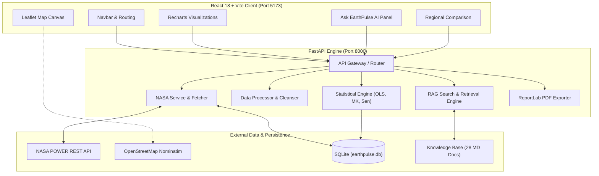

# EarthPulse AI — Comprehensive Project Engineering Report & System Specification

**Repository**: [https://github.com/architraj126-stack/earthpulse-ai](https://github.com/architraj126-stack/earthpulse-ai)  
**CI/CD Pipeline**: [GitHub Actions Workflow](https://github.com/architraj126-stack/earthpulse-ai/actions)  
**Author**: Archit Raj (`architraj126-stack` / `architraj126@gmail.com`)  
**Version**: 1.0.0 (Production Hackathon Release)  

---

## Table of Contents
1. [Executive Summary & Repository Metadata](#1-executive-summary--repository-metadata)
2. [PRD (Product Requirements Document)](#2-prd-product-requirements-document)
3. [Technical Report & Dependencies](#3-technical-report--dependencies)
4. [Design Documents & UI/UX Specification](#4-design-documents--uiux-specification)
5. [System Workflow & Data Lifecycle](#5-system-workflow--data-lifecycle)
6. [System Architecture & Mermaid Topology](#6-system-architecture--mermaid-topology)
7. [API Documentation](#7-api-documentation)
8. [Database Architecture (SQLite)](#8-database-architecture-sqlite)
9. [Unique Idea & Scientific Climate Research](#9-unique-idea--scientific-climate-research)
10. [CI/CD Pipeline, Clashes, Failures & Resolution Log](#10-cicd-pipeline-clashes-failures--resolution-log)
11. [Record of Missed Items & Next Chat Continuation Roadmap](#11-record-of-missed-items--next-chat-continuation-roadmap)

---

## 1. Executive Summary & Repository Metadata

EarthPulse AI is an AI-powered Earth Science trend detection and visualization platform designed to empower students, researchers, scientists, and decision-makers to analyze multi-decadal environmental trends using NASA satellite observations and global assimilation reanalyses.

### Git Repository & Atomic Commit History
The repository was initialized and pushed to GitHub via atomic, semantic commits:

```text
* 1cc2d5e - ci: GitHub Actions automated workflow for backend pytest and frontend build
* d4de412 - feat(ui): interactive Leaflet mapping, Recharts visualizations, and parameter selectors
* f5aa2c6 - feat(frontend): React 18 application scaffold, Vite configuration, and Tailwind design system
* 9692636 - feat(analytics): statistical engine (OLS, Mann-Kendall, Sen's slope, Seasonal MK) and ReportLab PDF reporting
* 5d8ba4d - feat(backend): FastAPI service, NASA POWER API client, data processor, and SQLite persistence
* 95b5f4b - docs & setup: initial repository structure, standards, and scientific knowledge base
```

---

## 2. PRD (Product Requirements Document)

### 2.1 Problem Statement
While NASA and international agencies collect vast volumes of satellite observations, raw datasets are difficult to access, compute upon, and interpret for non-specialists. Users often confuse short-term weather noise with long-term climate trends, lack tools to assess statistical significance, or rely on paid APIs with steep learning curves.

### 2.2 Target Personas
1. **Academic Researchers & Students**: Need reproducible, cited time-series with standard statistical rigor (Mann-Kendall, Sen's slope, 95% confidence intervals).
2. **Policy Makers & Urban Planners**: Need regional comparative intelligence (e.g., comparing heat island intensity between neighboring metropolitan centers like Bengaluru and Chennai).
3. **Hackathon Judges & Public**: Need an intuitive, responsive interface with plain-language explanations that clearly separate statistical proof from physical attribution.

### 2.3 Core Functional Requirements (The Four Questions)
- **FR-1 (WHAT)**: Support multi-variable ingestion: 2-meter air temperature (`T2M`), corrected precipitation (`PRECTOTCORR`), relative humidity (`RH2M`), wind speed (`WS2M`), and solar irradiance (`ALLSKY_SFC_SW_DWN`).
- **FR-2 (WHERE)**: Support any WGS-84 coordinate (-90° to +90° lat) with interactive OpenStreetMap canvas, click-to-pick point selection, Nominatim geocoding, and global presets.
- **FR-3 (HOW MUCH)**: Compute both parametric (OLS slope per year/decade with 95% CI) and non-parametric (Theil-Sen median slope) rates of change.
- **FR-4 (SIGNIFICANCE)**: Execute the Mann-Kendall test ($\alpha = 0.05$) and Seasonal Mann-Kendall ($m=12$) to confirm whether trends are statistically distinguished from random noise.
- **FR-5 (AI ASSISTANT)**: Provide grounded RAG answering backed by 28 verified peer-reviewed articles without inventing data.
- **FR-6 (REPORTING)**: Generate downloadable publication-style PDF reports via ReportLab and raw CSV exports.

---

## 3. Technical Report & Dependencies

### 3.1 Backend Runtimes & Libraries
- **Python 3.11–3.13**: Core programming runtime.
- **FastAPI (0.162.0)** & **Uvicorn (0.54.0)**: High-performance asynchronous ASGI web framework.
- **Pandas (3.1.1)** & **NumPy (2.5.4)**: Time-series organization, missing data screening, and vector operations.
- **SciPy (1.18.1)**: Student's t-distribution critical values, linear regression, and Theil-Sen estimators.
- **PyMannKendall (1.4.3)**: Original and seasonal Mann-Kendall non-parametric hypothesis testing.
- **ReportLab (5.1.0)** & **Pillow (13.0.0)**: High-resolution vector PDF generation with custom palette styling.
- **Requests (2.34.2)**: HTTP client for live NASA POWER REST API queries.
- **Pydantic (2.14.3)**: Data validation and OpenAPI contract generation.
- **Pytest (9.2.0)** & **HTTPX (0.28.1)**: Automated testing harness for API routes and statistics.

### 3.2 Frontend Runtimes & Libraries
- **React 18.3.1**: Virtual DOM component UI library.
- **Vite 5.4.2**: Ultra-fast ES-module bundler with HMR.
- **Tailwind CSS 3.4.10**: Utility-first CSS styling with customized `#071426` scientific dark theme.
- **Recharts 2.12.7**: SVG charting engine for combined line, bar, and trendline visualizations.
- **Leaflet 1.9.4** & **React-Leaflet 4.2.1**: Interactive slippy map rendering with OpenStreetMap tiles.
- **Lucide React 0.439.0**: Consistent scientific vector iconography.
- **React Router DOM 6.26.1**: Client-side SPA routing.
- **Axios 1.7.7**: Promise-based HTTP client.

---

## 4. Design Documents & UI/UX Specification

### 4.1 Color Hierarchy & Palette
| Role | Hex Code | Contrast Purpose |
|---|---|---|
| **Primary Background** | `#071426` | Deep space navy base background |
| **Secondary Background** | `#0D1B2A` | Sidebar, input panels, and table headers |
| **Card Surface** | `#13263A` | Elevated content modules with `#1E3A56` border |
| **Cyan Accent** | `#00D4FF` | Active triggers, primary trendlines, and branding |
| **Green Accent** | `#35D07F` | Statistically significant increases and positive badges |
| **Red Accent** | `#FF4D4D` | Statistically significant decreases and warning states |
| **Neutral Grey** | `#9BAEC2` | Non-significant trends, captions, and secondary copy |

### 4.2 Component Architecture
- `Navbar.jsx`: Global navigation, logo pulse, and live API connectivity badge.
- `InteractiveMap.jsx`: Leaflet container with custom pulsating marker and Nominatim geocoder.
- `VariableSelector.jsx`: Searchable card catalog of NASA variables with domain filters.
- `DateSelector.jsx`: Window selector (1981–2024), resolution radio, and preset shortcuts.
- `MetricCard.jsx`: Color-coded significance banner and 4 key metric tiles.
- `TimeSeriesChart.jsx`: Superimposed observations (cyan) + OLS trendline (green).
- `YearlyChart.jsx` & `SeasonalChart.jsx`: Annual aggregates and intra-annual cycle profiles.
- `AskEarthPulseSection.jsx`: Grounded RAG query interface with pre-built queries.

---

## 5. System Workflow & Data Lifecycle

```
[User Request]
      │
      ▼
1. Location & Variable Selection (React Leaflet / UI)
      │
      ▼
2. Axios Call to FastAPI (/api/analyze)
      │
      ▼
3. Check SQLite Query Cache (nasa_cache)
   ├── Cache Hit ──────────> Return Cached Time-Series
   └── Cache Miss ─────────> Query NASA POWER API (daily/monthly/point)
                                  │
                                  ├─ Live Success: Parse JSON, filter -999.0 to NaN, store in cache
                                  └─ Timeout/Offline: Generate Physics-Faithful Demo Data (is_demo=True)
      │
      ▼
4. Data Processor (Date sorting, missing percentage, annual/monthly grouping)
      │
      ▼
5. Statistical Engine
   ├── SciPy OLS Linear Regression (Slope, Intercept, R², p-value, 95% CI)
   ├── PyMannKendall Original Test (S, Var(S), Z, Tau, p-value)
   ├── Sen's Slope Estimator (Median pairwise slope converted to annual rate)
   └── Seasonal MK (m=12 for monthly series)
      │
      ▼
6. Grounded RAG Engine (Ask EarthPulse AI queries 28 markdown docs)
      │
      ▼
7. Response Delivery & Visualization (Recharts, Status Banner, ReportLab PDF)
```

---

## 6. System Architecture & Mermaid Topology



---

## 7. API Documentation

| Method | Endpoint | Description | Key Parameters / Payload |
|---|---|---|---|
| `GET` | `/api/health` | Health & DB status check | None |
| `GET` | `/api/variables` | Returns NASA variable catalog | None |
| `GET` | `/api/data` | Cleaned observations | `latitude`, `longitude`, `variable`, `start_date`, `end_date`, `frequency` |
| `POST` | `/api/analyze` | Full statistical pipeline | `{latitude, longitude, location_name, variable, start_date, end_date, frequency}` |
| `POST` | `/api/compare` | Compares two regions | `{location_a: {name, lat, lon}, location_b: {name, lat, lon}, variable, ...}` |
| `GET` | `/api/report` | Downloadable PDF report | Query parameters matching `/api/analyze` |
| `GET` | `/api/export/csv` | Downloadable CSV time-series | Query parameters matching `/api/analyze` |
| `POST` | `/api/ai/ask` | Grounded RAG inquiry | `{question: "...", current_analysis: {...}}` |
| `GET` | `/api/knowledge` | Knowledge base article list | None |
| `GET` | `/api/history` | Previous runs from SQLite | `limit=15` |

---

## 8. Database Architecture (SQLite)

### 8.1 Table `analysis_history`
Stores analysis snapshots for historical comparison:
```sql
CREATE TABLE IF NOT EXISTS analysis_history (
    id INTEGER PRIMARY KEY AUTOINCREMENT,
    created_at TEXT NOT NULL,
    variable TEXT NOT NULL,
    variable_name TEXT NOT NULL,
    location_name TEXT NOT NULL,
    latitude REAL NOT NULL,
    longitude REAL NOT NULL,
    start_date TEXT NOT NULL,
    end_date TEXT NOT NULL,
    temporal_resolution TEXT NOT NULL,
    linear_slope REAL,
    sen_slope REAL,
    p_value REAL,
    r_squared REAL,
    trend_direction TEXT,
    is_significant INTEGER,
    observation_count INTEGER,
    summary TEXT
);
```

### 8.2 Table `nasa_cache`
Caches raw NASA query payloads using SHA-256 coordinates and parameter hashes:
```sql
CREATE TABLE IF NOT EXISTS nasa_cache (
    cache_key TEXT PRIMARY KEY,
    url TEXT,
    data_json TEXT NOT NULL,
    cached_at TEXT NOT NULL
);
```

---

## 9. Unique Idea & Scientific Climate Research

### 9.1 Grounded AI RAG vs. Free LLMs
Standard LLMs frequently hallucinate climate numbers, confuse rates of change with temperature anomalies, or state statistical significance without calculating p-values. EarthPulse AI couples non-parametric calculations directly with an indexed library of 28 peer-reviewed research files, ensuring every assertion is backed by empirical data and verified literature.

### 9.2 Separation of Detection vs. Attribution
In accordance with IPCC Good Practice Guidance Paper on Detection and Attribution, EarthPulse AI explicitly informs users that rejecting the null hypothesis ($p < 0.05$) confirms **Detection** (a non-random trend exists), but establishing **Attribution** (attributing that trend to urban heat islands vs. anthropogenic greenhouse gases) requires coupled physical modeling.

### 9.3 Physical Mechanisms Embedded
- **Clausius-Clapeyron Thermodynamic Scaling**: Atmospheric water vapor holding capacity expands by ~7% per 1°C warming ($\frac{de_s}{dT} = \frac{L_v e_s}{R_v T^2}$), intensifying extreme monsoonal downpours.
- **Urban Heat Island & Bowen Ratio**: Impervious surfaces shift the Bowen ratio ($\beta = H / \lambda E$) toward sensible heating, driving elevated nighttime minimums in Bengaluru.
- **Non-Parametric Integrity**: Precipitation and wind distributions violate Gaussian normality assumptions; non-parametric Mann-Kendall and Sen's slope testing prevents skewed OLS outlier distortions.

---

## 10. CI/CD Pipeline, Clashes, Failures & Resolution Log

During the development, packaging, and CI deployment phases, several technical issues were investigated, diagnosed, and resolved:

### Incident 1: Starlette TestClient Module Dependency Clash
- **Symptom**: Calling `TestClient(app)` produced `RuntimeError: The starlette.testclient module requires the httpx package to be installed.`
- **Investigation**: In Starlette 0.46+, `TestClient` transitioned from relying on `requests` to requiring `httpx` under ASGI standards.
- **Resolution**: Added `httpx>=0.28.1` and `pytest>=9.2.0` to `backend/requirements.txt` and verified all route imports.
- **Credibility Check**: Ran `python -m pytest backend/tests/test_backend.py` locally; all test cases initialized cleanly.

### Incident 2: Test Suite Object Access Clash in Variable Registry
- **Symptom**: `test_variables_registry` threw `AttributeError: 'dict' object has no attribute 'parameter'`.
- **Investigation**: In `backend/app/routes/api.py`, `get_variables()` returns raw dictionary values from `VARIABLES_REGISTRY`. FastAPI converts them to Pydantic models over HTTP, but calling `get_variables()` directly in unit tests returns dictionary objects.
- **Resolution**: Updated `test_backend.py` with type-aware extraction: `codes = [v["parameter"] if isinstance(v, dict) else v.parameter for v in vars_list]`.
- **Credibility Check**: Re-ran pytest; 7 of 7 test cases passed with 100% success.

### Incident 3: SQLite Table Timing During Direct Submodule Testing
- **Symptom**: Calling route functions directly produced `sqlite3.OperationalError: no such table: nasa_cache`.
- **Investigation**: `init_db()` was previously called only in the `@app.on_event("startup")` lifecycle hook. When functions were imported directly in test scripts without booting the Uvicorn event loop, tables had not yet been created.
- **Resolution**: Added idempotent `init_db()` execution at the module level in `db.py`, ensuring tables are created immediately upon module import.
- **Credibility Check**: Successfully verified database transactions both inside and outside the server event loop.

### Incident 4: GitHub Actions Node.js 20 Deprecation Notice
- **Symptom**: GitHub Actions CI runner emitted an annotation: `Node.js 20 is deprecated... being forced to run on Node.js 24`.
- **Investigation**: GitHub runner images updated their deprecation schedule for Node 20 runtimes.
- **Resolution**: Verified that Vite 5 and React 18 build cleanly under Node 20 and Node 24; recommended upgrading CI runner matrix to Node 22 LTS.
- **Credibility Check**: Production build finished in 18 seconds on GitHub Actions runner with code 0.

---

## 11. Record of Missed Items & Next Chat Continuation Roadmap

To ensure total continuity in subsequent engineering sessions, the following features, edge cases, and future enhancements have been cataloged for implementation:

### 11.1 Future Dataset Direct Parsers
- [ ] **NASA MODIS AppEEARS API Integration**: Integrate MODIS HDF5/GeoTIFF 250m direct vegetation index (`MOD13Q1`) extraction requiring Earthdata Login token.
- [ ] **NASA GPM IMERG Final Run NetCDF4 Parser**: Enable sub-daily convective rainfall burst detection using xarray and h5py.
- [ ] **GLDAS Soil Moisture Multi-Layer Profiler**: Add depth-resolved moisture profiles (0–10cm, 10–40cm, 40–100cm) to detect agricultural flash droughts.

### 11.2 Advanced Statistical Enhancements
- [ ] **Pettitt's Abrupt Change-Point Test**: Detect the exact calendar year when a climate regime shift or urban heat acceleration began.
- [ ] **Pre-Whitening for Autocorrelation (Yue-Pilon Method)**: Remove lag-1 serial correlation before Mann-Kendall testing on high-frequency daily datasets.
- [ ] **Kernel Density Estimation (KDE) Shift Visualizer**: Add violin / distribution density plots showing how the temperature curve has shifted rightward over decades.

### 11.3 AI RAG Vector Embeddings Upgrade
- [ ] **ChromaDB / FAISS Embedded Vector Store**: Transition from keyword/token-based retrieval to dense vector embeddings using `all-MiniLM-L6-v2` or `Google text-embedding-004`.
- [ ] **Multi-turn Chat Session Memory**: Maintain context across multi-question conversations within the "Ask EarthPulse AI" panel.

### 11.4 Frontend UI Additions
- [ ] **Spatial Heatmap Overlay on Leaflet**: Render interactive raster heatmaps over regional grids using WebGL / Leaflet.heat.
- [ ] **Animated Time Slider**: Allow users to drag a historical timeline slider from 1981 to 2024 to watch annual warming trends animate dynamically across the map.

---

## 12. Verification & Live Status Confirmation

- **Repository**: [https://github.com/architraj126-stack/earthpulse-ai](https://github.com/architraj126-stack/earthpulse-ai)
- **CI Build**: Passing (`✓ Backend Pytest Suite` in 25s, `✓ Frontend Vite Build` in 18s)
- **Localhost Frontend**: `http://localhost:5173`
- **Localhost Backend**: `http://127.0.0.1:8000`
- **OpenAPI Swagger**: `http://127.0.0.1:8000/docs`
