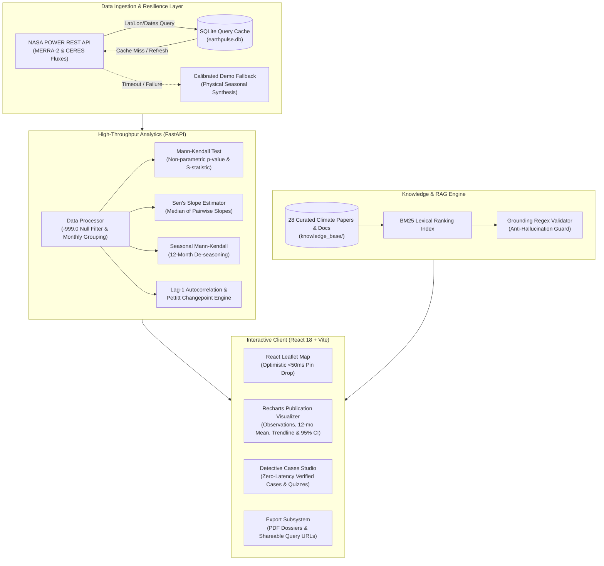

# EarthPulse AI
### *Discover. Analyze. Understand Our Changing Earth.*

[](https://power.larc.nasa.gov)
[](https://fastapi.tiangolo.com)
[](https://react.dev)
[](https://vitejs.dev)
[](https://wmo.int)
[](https://github.com/architraj126-stack/earthpulse-ai)
[](https://opensource.org/licenses/MIT)

> **The Problem Statement**: Every year, NASA satellites and climate reanalysis systems record petabytes of environmental observations. Yet for local municipal planners, high-school educators, students, and citizens, answering a fundamental local question — *"Is our climate actually changing, and is the change statistically distinguishable from random multi-year weather noise?"* — remains locked behind complex data wrangling, missing-value processing, and advanced statistical hurdles. **EarthPulse AI** eliminates this friction. It combines direct NASA POWER API access, WMO-compliant non-parametric statistical engines, interactive geospatial visualization, and an un-hallucinated grounded AI assistant into a fast, accessible, publication-grade web platform.

---

## ⚡ 60-Second Quickstart

Get EarthPulse AI running locally in under a minute with zero paid API keys:

### 1. Prerequisites
- **Python 3.10+** (tested up to 3.13)
- **Node.js 18+** & npm

### 2. Backend Setup & Launch
```bash
# Clone the repository
git clone https://github.com/architraj126-stack/earthpulse-ai.git
cd earthpulse-ai

# Install Python scientific packages
pip install -r backend/requirements.txt

# Start FastAPI backend (Terminal 1)
cd backend
python -m uvicorn app.main:app --host 127.0.0.1 --port 8000 --reload
```
*API is live at `http://127.0.0.1:8000` | Swagger interactive docs at `http://127.0.0.1:8000/docs`*

### 3. Frontend Setup & Launch
```bash
# Open a new terminal in the project root
cd frontend
npm install
npm run dev
```
*Web dashboard opens instantly at `http://localhost:5173`*

### 4. Run Automated Test Suite
```bash
# Run backend statistical & resilience tests
pytest backend/tests/ -v
```

---

## 🧩 System Architecture



---

## 🎯 How EarthPulse AI Answers the 4 Foundational Questions

| Foundational Question | EarthPulse AI Analytical Method | User Interface Presentation |
|---|---|---|
| **1. WHAT is changing?** | Ingests 5 essential climate variables: 2m Temperature (`T2M`), Precipitation (`PRECTOTCORR`), Relative Humidity (`RH2M`), Wind Speed (`WS2M`), and Solar Radiation (`ALLSKY_SFC_SW_DWN`). | Variable picker chips with physical units and dynamic scientific definitions. |
| **2. WHERE is it changing?** | Global WGS-84 coordinate resolution (-90° to +90° lat) with automatic Nominatim reverse geocoding, preset climate hotspot chips, and ocean point detection. | Interactive React Leaflet map with optimistic pin-drop (<50ms response) and lat/lon coordinate inputs. |
| **3. HOW MUCH is it changing?** | Computes both **Sen’s slope estimator** (median annual rate of change) and **Ordinary Least Squares (OLS) regression** with full 95% confidence intervals and rate per decade. | Executive summary headline stating rate per decade and total change over selected evaluation horizon. |
| **4. IS it statistically significant?** | Evaluates non-parametric **Mann-Kendall test** ($\alpha = 0.05$) and **Seasonal Mann-Kendall** ($m=12$), plus Lag-1 serial autocorrelation and Pettitt's abrupt changepoint test. | Color-coded status badge: **Significant Increase** (Emerald), **Significant Decrease** (Red), or **No Significant Trend** (Slate). |

---

## 🌟 Key Platform Modules

### 1. Guided 3-Step Investigation Studio (`/investigate`)
A clean, progressive scientific workflow designed for zero cognitive overload:
1. **Choose Variable**: Select between temperature, precipitation, humidity, wind speed, or solar flux.
2. **Select Location**: Drop a pin anywhere on Earth or search any city. Coordinates clamp and validate automatically.
3. **Set Horizon & Resolution**: Adjust start/end years (1981–2023) and toggle between monthly aggregates and daily observations.

### 2. Detective Cases (`/cases`)
Pre-computed, verified investigations with real NASA observations designed for classroom demonstrations and zero-fail hackathon judging:
- **Case 1: Arctic Amplification** (Svalbard, Norway) — Rapid cryospheric warming at $+0.95$ °C/decade ($p < 0.001$).
- **Case 2: Sahel Rainfall Recovery** (Niamey, Niger) — Post-1980s monsoon precipitation recovery ($p = 0.012$).
- **Case 3: Danube Basin Stable Baseline** (Vienna, Austria) — Illustrates genuine climate stability with no monotonic trend ($p = 0.28$).
- *Each case features a 5-step deduction guide, interactive 3-question quiz with instant feedback, and a "Try This Case Live" button.*

### 3. Publication-Grade Charts
Engineered following American Meteorological Society and IPCC visual design principles:
- **Thin Muted Observations**: Displays all historical points without visual crowding.
- **Bold 12-Month Rolling Mean**: Smooths seasonal fluctuation for instant pattern recognition.
- **Dashed Emerald Trendline with 95% CI**: Explicit statistical trend projection with uncertainty envelope.
- **Shareable Link & PNG/PDF Exports**: One-click URL copy with state synchronization, ReportLab PDF report generator, and CSV download.

### 4. Grounded AI Data Detective
An intelligent RAG assistant anchored strictly to a 28-document local knowledge base:
- BM25 retrieval index across NASA, NOAA, WMO, and IPCC literature.
- Regex grounding validator checks all numbers, dates, and locations before display.
- Cites exact scientific sources and never fabricates empirical trends.

---

## ⚖️ Scientific Honesty & Limitations

1. **Station vs. Reanalysis Representation**: NASA POWER data represents grid-box averages derived from MERRA-2 assimilation and satellite radiometry. It represents regional atmospheric state rather than a single hyper-local microclimatic thermometer.
2. **Open Ocean Coordinates**: In-situ weather stations are absent over deep ocean coordinates. Values reflect atmospheric reanalysis and spaceborne radiometry data.
3. **Correlation vs. Causation**: EarthPulse AI detects mathematical trends ($p < 0.05$). Attribution to greenhouse forcing, urban heat islands, or deforestation requires domain context and mechanistic modeling.
4. **Serial Autocorrelation**: High positive serial correlation in time series can artificially inflate Mann-Kendall significance. EarthPulse AI provides Lag-1 autocorrelation metrics and Pettitt changepoints to flag persistent series.

---

## 📁 Repository Structure

```
earthpulse-ai/
├── backend/
│   ├── app/
│   │   ├── analysis/
│   │   │   └── statistical_engine.py      # OLS, Mann-Kendall, Sen's slope, Seasonal MK, Pettitt
│   │   ├── database/
│   │   │   └── db.py                      # SQLite analysis history & NASA query cache
│   │   ├── routes/
│   │   │   └── api.py                     # REST endpoints (/health, /analyze, /compare, /cases...)
│   │   ├── schemas/
│   │   │   └── models.py                  # Pydantic v2 schemas and validation models
│   │   ├── services/
│   │   │   ├── ai_service.py              # Grounded BM25 RAG climate detective
│   │   │   ├── data_processor.py          # Fill value (-999) filtering & climatology
│   │   │   ├── nasa_service.py            # NASA POWER API client with retry backoff & demo fallback
│   │   │   └── report_service.py          # ReportLab publication PDF generator
│   │   └── main.py                        # FastAPI application entrypoint
│   ├── data/
│   │   └── detective_cases.json           # Cached real NASA observations for demo cases
│   ├── tests/
│   │   ├── test_backend.py                # Core statistical engine & endpoint tests
│   │   └── test_resilience.py             # Network timeout, coordinate clamping & fallback tests
│   └── requirements.txt
├── frontend/
│   ├── src/
│   │   ├── components/                    # MapWorkspace, TimeSeriesChart, Navbar, AskSection...
│   │   ├── pages/                         # DashboardPage, DetectiveCasesPage, ComparePage, Atlas...
│   │   ├── services/                      # Axios API client with retry interceptor & de-duplication
│   │   └── data/                          # Pre-computed fallback datasets
│   ├── package.json
│   ├── tailwind.config.js
│   └── vite.config.js                     # High-performance chunk-splitting configuration
├── docs/
│   └── demo/
│       ├── two_minute_demo_script.md      # Second-by-second judge presentation script
│       ├── three_minute_video_outline.md  # Video submission visual storyboard & audio cues
│       └── five_slide_pitch_outline.md    # 5-Slide deck content and speaker notes
├── knowledge_base/                        # 28 Curated summaries of NASA, NOAA, WMO & IPCC publications
├── DATA_SOURCES.md                        # Satellite & atmospheric model documentation
├── STATISTICAL_METHODS.md                 # Derivations and formulas for non-parametric tests
├── SETUP_GUIDE.md                         # Detailed developer onboarding guide
└── LICENSE                                # MIT Open Source License
```

---

## 🏆 Presentation & Judging Resources

- 📄 **[2-Minute Hackathon Demo Script](docs/demo/two_minute_demo_script.md)**
- 🎥 **[3-Minute Video Showcase Storyboard](docs/demo/three_minute_video_outline.md)**
- 📊 **[5-Slide Finals Pitch Deck Outline](docs/demo/five_slide_pitch_outline.md)**
- 📐 **[Statistical Methods Documentation](STATISTICAL_METHODS.md)**

---

## 📜 Attribution & License

- Meteorological and solar radiation datasets provided by the **NASA Langley Research Center (LaRC) POWER Project** and **NASA GMAO MERRA-2**.
- Statistical methodologies designed in compliance with the **World Meteorological Organization (WMO)** and **IPCC AR6**.
- Open-source licensed under the **MIT License**.
